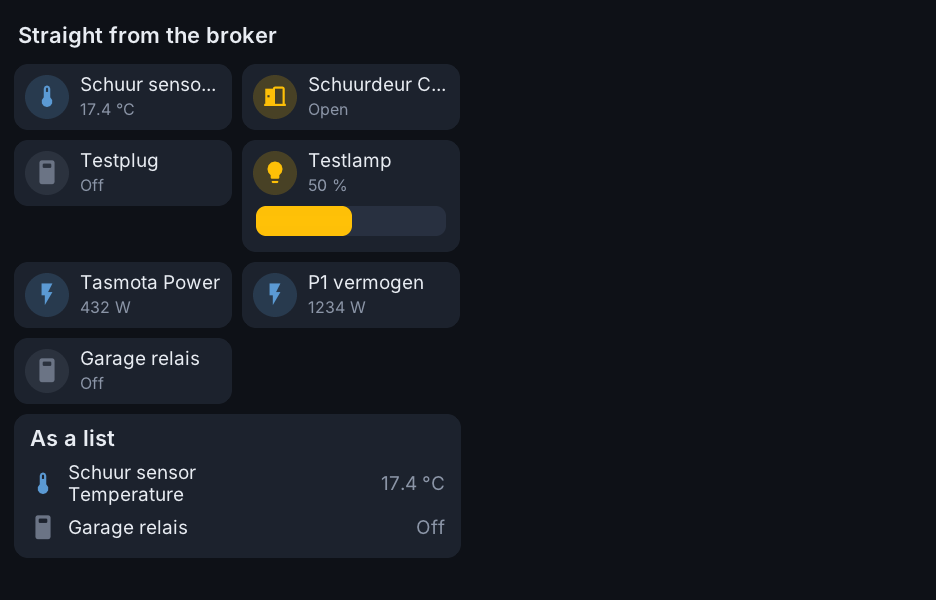

# MQTT

The Toon has its own MQTT broker, for the programs and apps on it and, when
you open it to the network, for your devices and scripts. Besides that, two
things use the broker set under Connections → MQTT (usually Home Assistant's):
`toon-mqttd` publishes the Toon there, and the screen can show and switch what
other devices publish there.

## The Toon's own broker

Mosquitto runs on every ReToon (`/etc/init.d/S41toon-broker`). It always
listens on 127.0.0.1:1883 without a password, so the programs on the Toon can
use it, and is not reachable from the network. Under Connections → MQTT →
"This ReToon's own broker" you can open it to the network: it then also
listens on the Toon's network address, port 1883, and asks for the user name
and password set there (`config/broker.conf`). Nothing is stored on flash:
kept messages live in memory and are sent again after a restart.

`toon-mqttd` puts the Toon's state on it and takes commands from it:

| Topic | What |
|---|---|
| `retoon/climate` | room temperature, humidity, light (`toon-sensord`) |
| `retoon/voc` | the air-quality sensor: index, word, trend (Toon 2) |
| `retoon/boiler` | thermostat and boiler: mode, target, room, preset, heat request, the OpenTherm values (`toon-boilerd`) |
| `retoon/motion`, `retoon/m4` | the proximity sensor and co-processor (Toon 2) |
| `retoon/control`, `retoon/outside` | the temperature the thermostat works with when other sensors are chosen, and the outside temperature |
| `retoon/ui`, `retoon/zwave`, `retoon/esphome` | the state of the screen and the radios |
| `retoon/meter` | the readings of the meter adapters that are read (Z-Wave tab), `n<node>_<what>` |
| `retoon/display` | `{"on":true,"brightness":80}` |
| `retoon/notify/event` | a tap on a message on the screen (as `notify/action` below) |
| `retoon/status` | `online` / `offline` |

Each state topic is one JSON object with the fields of the file the daemon
writes under `/run/toon` (numbers as numbers), retained, and sent when that
file changes, at most every 2 seconds. Commands:

| Topic | Payload |
|---|---|
| `retoon/boiler/set` | `hvac heat`, `hvac off`, `target 20.5`, `preset comfort` (`home`, `sleep`, `away`), `program resume`, `mode ot`, `mode onoff` |
| `retoon/display/set` | `ON`, `OFF` or a brightness 0–100 |
| `retoon/notify/set` | a message on the screen, as below |
| `retoon/ui/set` | `view 2` (show page 2, counted from 0) or `wake` |

A command that comes as a kept (retained) message is ignored, so nothing is
played back after a restart. Example, from a PC on the network:

```sh
mosquitto_sub -h toon-1a2b3c -u <user> -P <password> -v -t 'retoon/#'
mosquitto_pub -h toon-1a2b3c -u <user> -P <password> -t retoon/boiler/set -m 'target 20.5'
```

The files stay the source: the daemons read each other's files directly, so
the thermostat keeps working when the broker is not running. Apps use the
broker with `retoon.publish` and `retoon.subscribe` (see [apps.md](apps.md)).
When no broker is set under Connections → MQTT, the screen uses this one, so
devices you point at the Toon (Tasmota, ESPHome, zigbee2mqtt) can be put on
pages without Home Assistant.

## The Toon in Home Assistant (discovery)

`toon-mqttd` publishes the Toon to an MQTT broker with Home Assistant
discovery, so a device "Toon <id>" appears by itself. It is independent of
the screen's websocket link: either one can be used alone.

Set the broker in the web interface (Connections → MQTT). It is stored in
`/mnt/data/toon-os/config/mqtt.conf`:

```
host=192.168.1.10
port=1883
username=toon
password=...
discovery_prefix=homeassistant
```

### Entities

| Kind | Entities |
|---|---|
| Sensors | room temperature (what the thermostat works with: the average of the sensors chosen for it, or the Toon's own), internal temperature (always the Toon's own sensor), outside temperature (the boiler's over OpenTherm, or the sensor chosen for it), and with an OpenTherm boiler every other value it answers (hot water temperature, burner starts and hours, pump starts and hours, fan speed, maximum power, minimum modulation, …, on `toon/<name>/opentherm/<key>`), humidity, light, air quality (a word) and the raw air-quality index |
| Boiler (OpenTherm) | boiler water, return water, flow setpoint, hot water setpoint, maximum heating setpoint, modulation, water pressure, fault code, module message |
| Binary sensors | boiler module link, heat request, cool request (both also without a boiler module, for an external device: see [thermostat.md](thermostat.md)), flame, boiler fault, heating active, hot water active, cooling active (the boiler's status flags) |
| Climate | "Thermostat": off / heat / auto (auto follows the week program, heat holds the temperature: the same as the calendar button on the screen), target 6–30 °C in 0.5 steps, presets, current temperature, heating / idle |
| Select | "Boiler connection": OpenTherm, On/off; "Thermostat sensor": which of the sensors chosen in the web interface the thermostat works with: `Average` (all of them, as chosen), `Toon` (its own) or one of them by entity id (only when sensors other than the Toon's own are chosen) |
| Switch | "Thermostat lock": on keeps what is in force now, also over the week program's steps (the red border on the screen), off follows the week program again |
| Light | "Display": backlight on/off and brightness |
| Notify | "Notification": a message on the Toon's screen, see below |
| Event | "Notification button": a tap on such a message |

Topics are `toon/<name>/<key>`, where `<name>` is the Toon's hostname
without `toon-`: `toon/1a2b3c/...` for a Toon with its standard name,
`toon/kitchen/...` for one called `toon-kitchen` (System tab). Commands are on
`.../set`, availability on `toon/<name>/status` (last will). Home
Assistant's ids stay those of the Toon's own id (`toon_1a2b3c_...`), so
renaming a Toon changes its topics but not its entities. A renamed Toon also
still takes commands on `toon/<id>/.../set`, the topics before 1.26. The thermostat keeps its own mode and target
over a restart; commands are not kept on the broker. Values are sent as soon
as they change.

The room temperature comes from `toon-sensord`, which combines the two climate
sensors (ENS210, or HTS221 on some versions; one near the warm electronics)
and corrects for the warmth of the Toon itself.

## Notifications on the screen

Home Assistant (or anything else on the broker) can show a message on the
Toon, with a sound. A short message slides in as a banner at the top and goes
away by itself; tapping it opens the whole text. A message with buttons, an
alert, or one that has to stay shows as a popup in the middle until it is
answered.

The simplest way is the notify entity, from an automation or script:

```yaml
action: notify.send_message
target:
  entity_id: notify.toon_1a2b3c_notify
data:
  message: The washing machine is done
```

For more, publish JSON to `toon/<id>/notify/set` (plain text there is the
message on its own):

```yaml
action: mqtt.publish
data:
  topic: toon/1a2b3c/notify/set
  payload: >-
    {"title": "Doorbell", "message": "Someone is at the door. Open?",
     "level": "alert", "icon": "mdi:doorbell",
     "buttons": ["Open", "Ignore"], "tag": "door", "sound": "chime"}
```

| Field | Meaning |
|---|---|
| `title`, `message` | The text. A message alone is fine. |
| `level` | `info` (default), `warning` or `alert`: the colour, the icon and the default sound |
| `icon` | An `mdi:` icon instead of the one for the level |
| `style` | `banner` or `popup`. Default: a popup for an alert, with buttons or with `timeout` 0; a banner otherwise |
| `timeout` | Seconds until it goes by itself; 0 = until it is tapped. Default 10 for a banner, 0 for a popup. A `{s}` in the title or message shows the seconds left, counting down: `"Garage closes in {s} s"` |
| `buttons` | Up to three labels. A tap closes the popup and is reported (below) |
| `sound` | `none`, `beep`, `chime`, `alarm` (again every 3 seconds while the popup is open, at most 2 minutes) or the name of a WAV file in `/mnt/data/toon-os/sounds` (without `.wav`). Default: none for info, beep for a warning, chime for an alert |
| `volume` | 0–100; default the volume set under System → Sound |
| `tag` | A new message with the same tag takes the place of the old one. `{"tag": "door", "dismiss": true}` takes it away, for example when someone opened the door elsewhere |
| `wake` | `false`: a dimmed screen stays dimmed |

Only a `sound`, without title and message, plays the sound and shows nothing.

A tap on a button, or on close, fires the event entity "Notification button"
(`toon/<id>/notify/action`): event type `button` with the button's label in
`button`, or `dismissed`, both with the message's `tag` and `title`. A message
that goes by itself or is replaced reports nothing. To act on an answer:

```yaml
triggers:
  - trigger: state
    entity_id: event.toon_1a2b3c_notify_action
conditions:
  - condition: template
    value_template: >-
      {{ trigger.to_state.attributes.event_type == 'button'
         and trigger.to_state.attributes.tag == 'door'
         and trigger.to_state.attributes.button == 'Open' }}
actions:
  - action: lock.unlock
    target:
      entity_id: lock.front_door
```

The same JSON works without MQTT, through the web interface's API
(`POST notify`, see [web-interface.md](web-interface.md)), and from apps
(`retoon.notify`, see [apps.md](apps.md)). The Screen tab of the web
interface has two buttons to try it.

The Toon 2 plays sounds on its buzzer: beeps and chimes are fine, speech and
music are not. The Toon 1 has a real speaker.

## Pages from MQTT data

The screen (`mqtt.c` in `toon-ui`) connects to the same broker and offers
what it finds as `mqtt.*` entities, for the same cards as everything else.
With these a Toon is useful without Home Assistant at all.



- **Devices that announce themselves.** Everything published under the
  discovery prefix (`homeassistant/<component>/.../config`, as zigbee2mqtt,
  Tasmota, ESPHome and others do) is listed in the card editor, marked
  "(MQTT)". Sensors and binary sensors are shown; switches and lights can be
  switched, lights also dimmed (JSON schema, or separate brightness topics).
  Other kinds are shown with their state but not operated.
- **Your own topics.** Connections → "Your own MQTT values" (in the MQTT card): a name, a topic,
  optionally the field in a JSON message (`data.power`), a unit, and for a
  switch the topic and texts to switch it. Stored in
  `config/mqtt-topics.json`.

Only the topics of entities that are on a page are subscribed. Value
templates are not run: `value_json.a.b` is taken out of the template and used
as the place of the value, which covers what devices publish in practice;
templates that calculate are shown unprocessed. Availability topics are
ignored. The connection is not encrypted.
