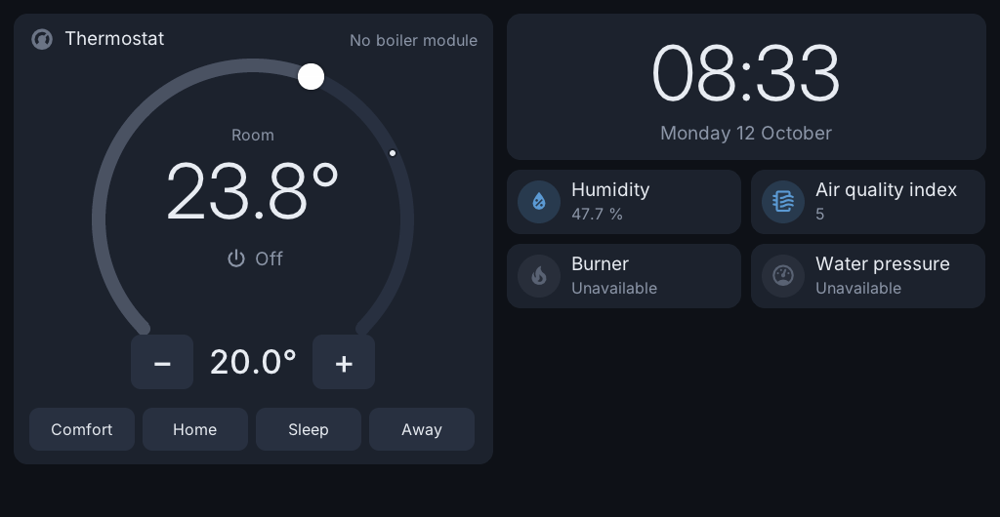
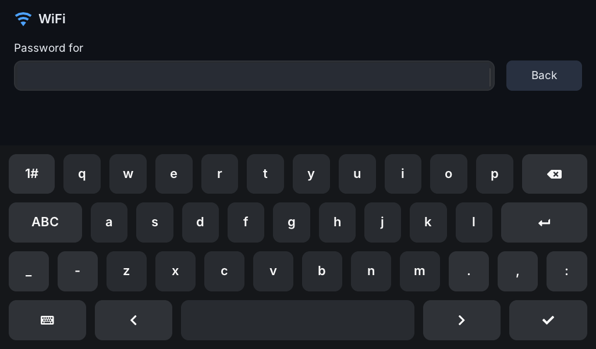
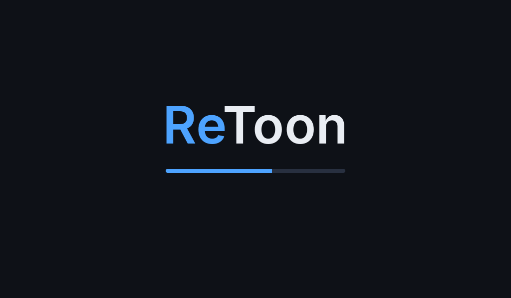

# The screen (`toon-ui`)

`toon-ui` draws on the framebuffer with [LVGL](https://lvgl.io) and reads the
touchscreen directly. There is no browser on the Toon: a test with WPE WebKit
and the Home Assistant web interface kept the single 1 GHz core at 100 % and
was unusably slow. The native screen idles at a few percent.

| Standard home page | WiFi setup |
|---|---|
|  |  |

## Using it

- **Pages:** buttons in the bar at the bottom, or swipe left and right; a
  swipe slides the next page in (on a Toon 2; on a Toon 1 it is off, as it
  cannot draw it smoothly). Dragging a slider or a thermostat ring does not
  count as a swipe, and a swipe does not press the card it started on. (The
  WiFi picture above is from before the bar moved from the left side to the
  bottom.)
- **Dimmed:** when the screen dims, the home page can show a page of its
  own, full screen without the bar (a big clock, for example). The touch that
  wakes the screen only shows the normal home page; it presses nothing.
- **Tiles:** a tap switches lights, switches, fans and input booleans, runs
  scenes and scripts, presses buttons and toggles media playback. Locks,
  covers and alarms are not switched by a plain tap.
- **WiFi icon:** opens the WiFi screen. It also opens by itself when no WiFi
  is configured, or when the connection has been down for a minute. A failed
  attempt puts the previous settings back.
- **Home Assistant icon:** green when connected. Tap it for the address, user
  name and password of the web interface.
- **MQTT:** green when connected to the broker, amber when it cannot be
  reached, grey when none is set.

In the corner, from the right: clock, WiFi, Home Assistant, MQTT.

## The thermostat card

The `thermostat` card is a dial, and the first page of a new ReToon is built
around it (first picture above). The ring and its knob are the temperature
asked for: turn the knob or use − and +. The large number is the room now,
with a small dot on the ring at that temperature. The ring is orange while
heating, blue when the target is reached and grey when off. It works for the
Toon's own thermostat and for any `climate` entity of Home Assistant.

On the Toon's own thermostat, with the week program on, the active preset
button shows who chose it, and the line under "Idle"/"Heating" says what
comes next:

- **no border**: the week program chose it ("Then Sleep at 23:00");
- **orange border**: chosen by hand; the program takes over again at its
  next step (an hourglass and "Temporary until 23:00");
- **red border**: tap the button with the orange border again to lock it:
  the program leaves it as it is (a lock and "Locked"), and the temperature
  can not be changed (the ring and − / + are greyed out; a change from Home
  Assistant or the web interface is ignored too). Tap it once more to
  unlock: the program's preset for now is chosen again.

A temperature or preset set from Home Assistant counts as a choice by hand,
just like on the screen.

Only the knob turns the ring: a touch elsewhere on the ring (a hand brushing
past, cleaning the screen) does nothing, and tapping the knob without turning
it changes nothing either. (Before 1.33 a touch on the ring moved the target
to that spot, up to 30 °C at the bottom right.)

The calendar button at the end of the preset row switches the week program
on or off (blue when on; the same setting as "Week program" in the web
interface). Without a boiler module the card says so top right ("External
device" when it heats and cools for one, see [thermostat.md](thermostat.md)).

For a page with several thermostats the card has smaller styles (`style`
in the card, "Style" in the editor):

| `style` | Height | What it shows |
|---|---|---|
| `dial` (default) | its cells, at least four rows | the dial above, with the mode or preset buttons |
| `compact` | three tile rows | a small dial: ring and knob, the room in the middle, the target between − and + |
| `bar` | two tile rows | icon, name and state, the room large, a slider for the target |
| `row` | one tile row | icon, name, "Heating · 19.4 °C", the target between − and + |

The small styles fit a tile's size (the card's place in the grid, see
below): two `compact` dials next to each other and four `row` cards under
each other fit in half a page, so a page can hold eight thermostats.

## Start-up picture



`toon-splash` draws the name and a progress bar straight on the framebuffer.
It is the first init script (`S00toon-splash`) and ends when `S50toon-ui`
starts the screen, about nine seconds later. The bar moves by time, not by
real progress. What U-Boot shows before the kernel starts is untouched.

## Dashboard format

Pages are stored in `/mnt/data/toon-os/config/dashboard.json`. The cards
are Home Assistant's own (a card copied from Home Assistant works as it is),
but a page is a grid of its own: 12 columns over the page's width, rows a
tile high, and every card has its place in it, `position` with `x` and `y`
(the top left cell, from 0) and `w` and `h` (columns and rows):

```json
{ "views": [ { "title": "Home", "icon": "mdi:home", "type": "retoon-grid",
    "cards": [
      { "type": "thermostat", "entity": "toon.thermostat",
        "position": { "x": 0, "y": 0, "w": 6, "h": 7 } },
      { "type": "custom:toon-clock", "position": { "x": 6, "y": 0, "w": 6, "h": 2 } },
      { "type": "tile", "entity": "toon.temperature",
        "position": { "x": 6, "y": 2, "w": 3, "h": 1 } },
      { "type": "tile", "entity": "light.living_room",
        "features": [ { "type": "light-brightness" } ],
        "position": { "x": 9, "y": 2, "w": 3, "h": 2 } } ],
    "dimmed": { "type": "retoon-grid", "cards": [
      { "type": "custom:toon-clock", "position": { "x": 0, "y": 0, "w": 12, "h": 8 } } ] } } ] }
```

`dimmed` in the first page (the home page) is the page shown while the
screen is dimmed: the whole screen, 8 rows, no bar.

Without that file the pages from `/usr/share/toon/default-dashboard.json` are
shown. The file is watched: saving it rebuilds the screen.

### Cards

| Card | Notes |
|---|---|
| `tile` | name, state, icon, `color`, `hide_state`, our own `name_size` / `state_size` (`small`, `large`, `x-large`) and `name_color` / `state_color` (a colour name such as `red` or `#rrggbb`; Home Assistant does not use these four), `tap_action` (`toggle`, `none`, `navigate`, `perform-action` with `perform_action`, `target`, `data`; `confirmation`: `true` or `{ "text": ... }` asks "Are you sure?" first) |
| tile features | `light-brightness`, `media-player-volume-slider`, `target-temperature`, `select-options`, `climate-hvac-modes`, `climate-preset-modes` (the first known one is used). The button rows take their list as in Home Assistant (`options`, `hvac_modes`, `preset_modes`): only those, in that order, at most 5; without it all the entity's options |
| `heading` | `heading`, `icon`, `heading_style` |
| `thermostat` | a dial: room and target temperature, − / +, mode buttons; `style` `compact`, `bar` or `row` for smaller cards (see above) |
| `entities` | a list with name and state per line |
| `history-graph` | a line per entity over `hours_to_show` (default 24); one graph per unit; `name` and `color` per entity. Numbers only, on/off timelines are not drawn |
| `statistics-graph` | Home Assistant's long-term statistics: `days_to_show` (30), `period` (`5minute`, `hour`, `day`, `week`, `month`), the first of `stat_types`, `chart_type: bar`; `change` (energy meters) is drawn as bars |
| `sensor` with `graph: line` | the value and a small line over `hours_to_show` (`detail: 2` for six points an hour); without `graph` it is a tile |
| `energy-usage-graph`, `energy-solar-graph`, `energy-gas-graph` | from Home Assistant's energy settings: the grid's energy in and out, solar or gas an hour over the last 24 hours, as `statistics-graph` bars; `title` |
| `energy-distribution` | today's totals from the energy settings: from and to the grid, solar, gas, and what the house used (from the grid + solar − to the grid); new every five minutes; `title` |
| `energy-date-selection`, `energy-compare` | not shown: the energy cards show today |
| `markdown` | shown as plain text |
| `grid`, `vertical-stack`, `horizontal-stack`, `conditional` | layout only; conditions are ignored |
| `custom:toon-clock` | time and date; `"style": "analog"` for a clock with hands: on black (`"background": "card"` for the card colour), colours `dial_color` (the edge, and what the others follow), `hands_color`, `marks_color` (hours) and `minute_marks_color` (a colour name or `#rrggbb`), `"seconds": true` for a seconds hand. `"background": "black"` makes the digital clock black too |
| anything else | shown as a tile (if it has `entity`) or a list (if it has `entities`), otherwise a note that it is not shown |

### Example: an EV charger

Any charger with a Home Assistant integration that has a select entity for
its charging mode (myenergi zappi, Wallbox, easee, go-e, OCPP, ...) can get
its own page from plain cards: the modes as buttons, the live values as
tiles, and actions (a boost) as tiles that ask first. The entity and action
names below are examples; use the ones of your integration.

```json
{ "type": "retoon-grid", "title": "Charging", "icon": "mdi:ev-station", "cards": [
  { "type": "heading", "heading": "Charger", "icon": "mdi:ev-station",
    "position": { "x": 0, "y": 0, "w": 6, "h": 1 } },
  { "type": "tile", "entity": "select.charger_charge_mode", "name": "Mode", "hide_state": true,
    "features": [ { "type": "select-options", "options": [ "Fast", "Eco", "Eco+", "Stopped" ] } ],
    "position": { "x": 0, "y": 1, "w": 6, "h": 2 } },
  { "type": "tile", "entity": "sensor.charger_power", "name": "Power",
    "position": { "x": 0, "y": 3, "w": 3, "h": 1 } },
  { "type": "tile", "entity": "sensor.charger_status", "name": "Status",
    "position": { "x": 3, "y": 3, "w": 3, "h": 1 } },
  { "type": "tile", "entity": "sensor.charger_session_energy", "name": "This session",
    "position": { "x": 0, "y": 4, "w": 3, "h": 1 } },
  { "type": "heading", "heading": "Boost", "icon": "mdi:rocket-launch",
    "position": { "x": 6, "y": 0, "w": 6, "h": 1 } },
  { "type": "tile", "entity": "select.charger_charge_mode", "name": "Boost 10 kWh",
    "icon": "mdi:rocket-launch", "hide_state": true,
    "tap_action": { "action": "perform-action", "perform_action": "myenergi.myenergi_boost",
      "target": { "entity_id": "select.charger_charge_mode" }, "data": { "amount": 10 },
      "confirmation": { "text": "Boost 10 kWh, also from the grid?" } },
    "position": { "x": 6, "y": 1, "w": 3, "h": 1 } } ] }
```

The same page can be made in the web interface without typing JSON, see
[web-interface.md](web-interface.md#example-an-ev-charger-page).

### The grid

A row is as tall as makes seven rows fill the screen above the bar exactly
(63 pixels on a Toon 2, with 10 between them), so a page of whole rows ends
just above the bar; rows below that are seen by scrolling. A card gets
exactly its cells: a taller tile shows its contents in the middle, a graph
or an app uses the height, and what does not fit (a long list in a small
card) is cut off. Cells without a card stay empty.

```json
{ "type": "custom:retoon-app", "app": "powerflow", "position": { "x": 0, "y": 0, "w": 6, "h": 5 } }
```

Pages in Home Assistant's own layout (`sections`, or a list of `cards` over
columns, as in older versions of ReToon) are turned into a grid once, when
the screen first loads them: each card gets the cells it was shown in. The
dashboard from before is kept as `config/dashboard.json.before-grid`. Pages
copied from Home Assistant in the web interface are turned into a grid there,
in their order.

### The Toon's own entities

These work without Home Assistant and can be used in any card:

`toon.temperature`, `toon.humidity`, `toon.illuminance`, `toon.air_quality`,
`toon.thermostat`, `toon.boiler_connection`, `toon.boiler_water`,
`toon.return_water`, `toon.flow_setpoint`, `toon.hot_water_setpoint`,
`toon.max_heating_setpoint`, `toon.modulation`, `toon.water_pressure`,
`toon.fault_code`, `toon.boiler_fault`, `toon.boiler_message`, `toon.flame`,
`toon.heat_request`, `toon.display`, `toon.wifi`, `toon.internal_temperature`,
`toon.outside_temperature`.

`toon.temperature` is the room temperature the thermostat works with: with
other sensors chosen for the thermostat, their average; otherwise the Toon's
own sensor. `toon.internal_temperature` is always the Toon's own sensor.
`toon.outside_temperature` is the outside temperature the thermostat works
with: the boiler's (OpenTherm) or the sensor chosen for it.
`toon.heating_active`, `toon.hot_water_active` and `toon.cooling_active` are
the boiler's status flags (OpenTherm id 0), like `toon.flame`.

With an OpenTherm boiler, its other values come as entities of their own as
soon as the boiler answers them, for example `toon.hot_water_temperature`,
`toon.burner_starts`, `toon.burner_hours`, `toon.fan_speed`,
`toon.max_capacity`, `toon.min_modulation`, the other start and hour
counters, and where the boiler has them `toon.exhaust_temperature`,
`toon.heat_exchanger_temperature`, `toon.hot_water_flow`, `toon.flame_current`,
the solar and second-circuit temperatures. A value the boiler does not answer (or answers as invalid) is not
there, or unavailable.

## Home Assistant link

- `ws://` or `wss://` to `/api/websocket`. A certificate is only checked
  with `verify=1` in `ha.conf`.
- Only the entities used on the pages are subscribed (`subscribe_entities`),
  so the size of the installation does not matter.
- Graphs ask for their history once, then add each new state as it comes:
  `history/history_during_period`, or for graphs over two hours of entities
  with a `state_class` the 5-minute statistics
  (`recorder/statistics_during_period`) plus the history of the last minutes
  the statistics do not have yet. A fast sensor's history is large, and
  parsing it blocks the screen: on a Toon 1 (no FPU) 6 hours of a 1/s power
  sensor took 1.8 s, 24 hours 8 s (Toon 2: 0.13 s and 0.5 s). After the link
  was down they ask again, to fill the gap.
- `config/ha.conf` holds `url=`, a long-lived `token=` (made by the web
  login or pasted) and `verify=`. `toon-ha token` turns that into an address
  and access token; host names ending in `.local` are found with mDNS. Older
  logins that stored `refresh_token=` / `client_id=` keep working.
