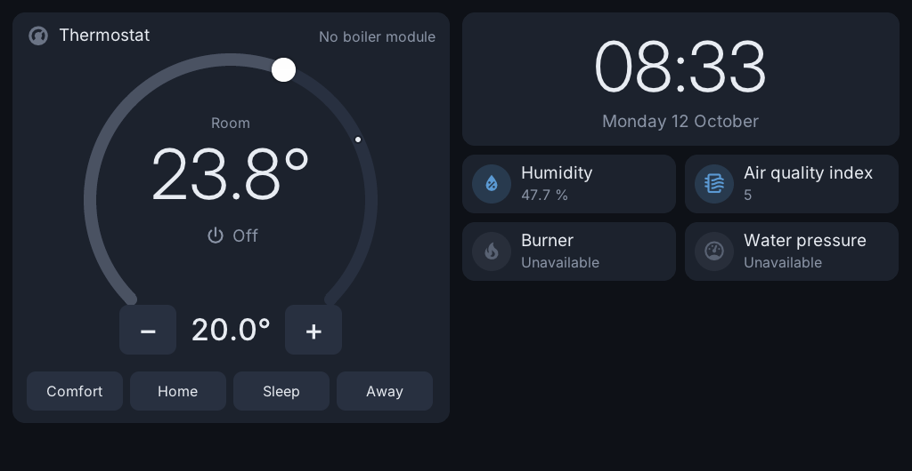

# The thermostat

The thermostat runs on the Toon itself (`toon-boilerd`, `thermostat.c`) and
keeps working without the network, Home Assistant or the screen program.

## On the Toon

Only what is needed day to day: the four presets (Comfort, Home, Sleep,
Away) and the dial with − and + for a temperature by hand. Either one also
switches the thermostat on. Everything else is set in the web interface,
on the Thermostat tab.

## What it does

- **Presets.** Four temperatures, standard 20 / 18 / 15 / 12 °C.
- **Week program.** Per day a list of times and presets. A preset or
  temperature chosen by hand holds until the next step of the program;
  without a program it stays. "Back to the program now" in the web interface
  ends a hold early.
- **Control rule (OpenTherm).** Once a minute, with two numbers learned
  about the house: *loss* (degrees a minute the room loses with the boiler
  idle) and *factor* (degrees a minute it gains per degree the boiler water is
  above the room):

  `flow = T − loss / factor + (T − room − offset) × 3 / (60 × factor)`

  limited to 6 °C .. the boiler's maximum. **Heat is asked for when this flow
  is above 30 °C**, and stops once it is below that by what 0.15 °C of room
  makes in the flow (at least 2 °C), so a sensor in 0.1 °C steps does not
  switch the boiler every few minutes; there is no band around the room
  temperature. *offset* (−1.5 .. +0.5) follows, every four hours, how far
  the room stayed from the target in steady running (not while starting
  early or stopping for after-heat). *factor* is measured over stretches of
  at least 8 minutes of heat at a steady water temperature (the maximum for
  the flow rule; a long stretch leaves out its first 10 minutes; start value
  0.001 until three exist), *loss* over hours of rest from 90 minutes after
  the last heat, and only when the room cools (sun does not count).
- **Heat loss by the outside temperature.** A house loses heat in proportion
  to the difference with outside: `loss = −k × (T − outside)`. When an
  outside temperature is known (OpenTherm, or the sensor chosen for it), *k*
  is measured in the same hours of rest, when it is at least 3 °C colder
  outside than inside. From three such measurements on it takes the place of
  the fixed *loss* in the rule, in starting early and in measuring *factor*:
  on a cold night the thermostat asks for warmer water and starts earlier,
  on a mild one less. Without an outside temperature the fixed *loss* stays.
  The web interface shows it as degrees an hour per 10 °C colder outside.
- **After-heat.** After a burst of heat the room keeps warming from the hot
  radiators. The thermostat counts the heat put in, fading over about 20
  minutes, follows the room after every stop to its peak and learns how far
  it rises per unit of heat. Once learned (three clear peaks) the heat stops
  as soon as what is in the radiators will bring the room to the target, and
  it does not start while even a 2-minute burst would overshoot by more than
  half its own swing. A pulse stopped so is over for its cycle. With a
  modulating boiler this only counts while it is asked for full
  temperature (the rule turns the flow down near the target itself). It is
  learned per way of heating (each way keeps its own). The Thermostat page
  shows how much the room still rises after 10 minutes of heating.
- **Pulses count real heat.** `toon-boilerd` waits 3 minutes after a stop
  before it asks for heat again; the pulses count the minutes the boiler
  really heated, so a pulse that had to wait comes later in its cycle
  instead of being lost, and the shortest pulse is 2 minutes of real heat.
- **What it learns from.** Where the boiler reports its own flow
  temperature (OpenTherm id 25) the warming rate is measured with that
  instead of the one asked for. A change of room sensor (another sensor,
  or the Toon's own taking over), a jump of more than 0.4 °C in a minute,
  a gap in the readings or the cooling season start the measurements again.
- **Safety.** A room reading that is not a number ("nan") or outside
  −30 .. 60 °C counts as no reading: no heat on it. A sensor from Home
  Assistant or MQTT only counts while that connection is up (its last value
  could be hours old); an MQTT sensor counts again after a reconnect once it
  sends a new value (a retained one comes at once). When none is left, the
  Toon's own sensor takes over after three minutes. A boiler maximum (OpenTherm id 57) from 20 °C is
  taken as real; when it is at or below the start point (30 °C) heat starts
  2 °C below it, so such a boiler can still heat (and protect against frost).
- **Starting from the original software.** Once, when nothing is learned yet,
  what the Toon's original software had learned about the house (still on
  the data partition) is used as the starting point. A Toon that never
  heated with it has nothing to take over.
- **Starting early.** Before a step to a warmer preset:
  `minutes = (next − room − minutes_left × loss) / ((max − room) × factor) + 15`.
  The target is raised when that reaches the minutes left, at most the number
  of minutes set (standard 180). Once started it holds until the step. After each start
  the thermostat checks when the room got to the step's temperature: early
  or late, half of that (in minutes) is added to a learned correction
  (−60 .. +120 minutes) that the next start uses. It counts as early only
  when the room is still warm at the step; there before but cooled off again
  counts as late. A start that ends without its step (the program or target
  changed) does not count.
- **On/off boilers.** Heat below target − 0.2 °C, none above target + 0.2 °C.
  The boiler counts as "full" while it is on, so learning and starting early
  work the same way. Also used for OpenTherm with "Choose the boiler's water
  temperature…" off (then 40 °C plus 20 °C per degree).
- **District heating (OpenTherm, temperature not followed).** Some heat
  sources talk OpenTherm but deliver hot water whatever is asked for, as most
  district heating sets do. Near the target the rule above asks for
  lukewarm water and keeps the heat on, hot water arrives and the room
  overshoots: every time the heating stops it keeps getting warmer for a long
  while. "OpenTherm, but the heat source does not follow the water temperature
  asked for" (`"flow_ignored": true`) switches over to the pulses of an on/off
  boiler, over OpenTherm (the maximum water temperature is asked for while on),
  and counts the source as full while on, so the learning measures the house
  as it is really heated. The other OpenTherm values stay.
- At least three minutes pass between two heat requests.
- **Frost protection.** Below the frost temperature (standard 5 °C) heat is
  asked for until one degree above it, also with the thermostat off.
- **Remembering.** Mode, target, preset, a hold and what was learned are kept
  in `config/thermostat.state`, so a restart changes nothing. A new unit
  starts with the thermostat off.

All rates above are per minute.

## Which temperature

Thermostat tab, Temperature sensors: the Toon's own sensor and any
number of temperature sensors from Home Assistant or MQTT. The thermostat
works with the average of those that answer. `toon-ui` keeps that average in
`/run/toon/control`; when it is missing or older than three minutes (no
sensor answers, or the screen program is not running) `toon-boilerd` uses the
Toon's own sensor, also when that one was not chosen.

**Correction of the ReToon's own sensor.** When the Toon's own sensor reads
too high or too low (a warm wall, sun on the case), "Correction of the
ReToon's own sensor" adds −5.0 .. +5.0 °C in steps of 0.1 to it
(`"temp_offset"` in `thermostat.json`). `toon-sensord` applies it, so the
screen, Home Assistant and the thermostat all get the corrected value; on the
Toon 2 the humidity is restated for it. The web interface shows the value
with and without the correction.

## Without a boiler: an external heater or airco

Boiler page, Boiler connection: "Heat and cool with an external device".
`heat=1` / `cool=1` in `/run/toon/boiler`, `toon.heat_request` /
`toon.cool_request` on the screen and "Heat request" / "Cool request" in Home
Assistant follow the thermostat; an automation there can switch a heater, a
heat pump or an airco with them. ("Heat request" is there with any boiler.)

- Without a boiler module the thermostat then still decides when to heat
  (and, with "Use cooling", when to cool), the same way as for a boiler on
  the on/off contact: the on/off cycle, the minimum pause, presets, week
  program, holds and locks.
- Next to a boiler that can not cool (on/off contact, or OpenTherm without
  cooling) the cooling goes to the external device: in the cooling season
  the boiler is not asked for heat, and nothing about cooling is sent to it.
- With an OpenTherm boiler that can cool, the setting changes nothing.

## Choosing the sensor from Home Assistant

The select "Thermostat sensor" ([mqtt.md](mqtt.md)) picks which of the
sensors chosen in the web interface the thermostat works with: `Average`
(all of them, the standard), `Toon` (its own sensor) or one of the others.
An automation can so follow the room where someone is. The choice is kept in
`thermostat.json` (`sensor_use`); a sensor that is no longer chosen, or one
that does not answer, falls back to the average or the Toon's own sensor.

## The change log

Thermostat page, "Keep a log of thermostat changes" (off by default): a line
for each change of on/off, target, preset, hold, lock, week program or
pre-heating, with where it came from:

| Source | |
|---|---|
| `screen` | a tap or the dial on the Toon |
| `web` | the web interface |
| `ha` | Home Assistant (over MQTT) |
| `app` | an app or another client of the Toon's own broker (`retoon/boiler/set`) |
| `program` | the week program, pre-heating, or a temporary choice that ended |
| `settings` | new settings saved in the web interface |
| `start` | the state when `toon-boilerd` started |

`2026-11-10 07:00:00 program: target 18.0 -> 20.0, preset home -> comfort`.
Kept in `/mnt/data/toon-os/thermostat-changes.log` (p4, so it stays over a
restart and an update), the newest 64 kB plus one older file; "Show the log"
in the web interface shows both, newest first.

## The measurement log

"Keep a measurement log" (Thermostat page, `"log_measurements"`, off by
default) writes a CSV line a minute to
`/mnt/data/toon-os/thermostat-measurements.csv`: time, room, target, the
target worked towards, pre-heating, the flow asked for, heat wanted and
heating, and what the boiler reports (flame, water and return temperature,
modulation; empty when it does not say), the outside temperature, the
pulse minutes of this cycle, a stop for after-heat, the way of heating, and
what was learned (warming rate in °C an hour, factor, loss, k, after-heat,
the pre-heat correction, offset). It is kept in memory and written every 10
minutes; about 300 kB a file (almost two days) and one older file.
"Download the measurements" gives both as one file (`GET
/thermostat/measurements`).

## Not tested

All of the above was tested on a unit without a boiler module connected:
program steps, holds, starting early (the decision, not the result), the
sensor average, saving and restoring. The control rule was run against a
simple simulated house (it reaches and holds the target and learns loss and
factor close to the simulated ones). **No heat has been requested from a
real boiler with this code yet**, so none of it has been seen working on one.
