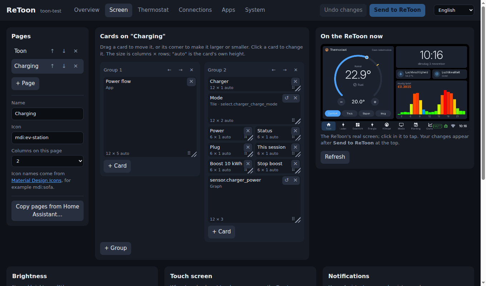
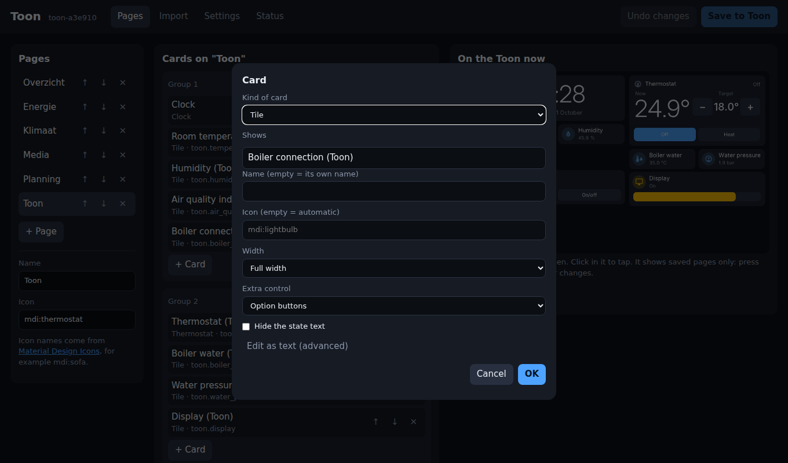
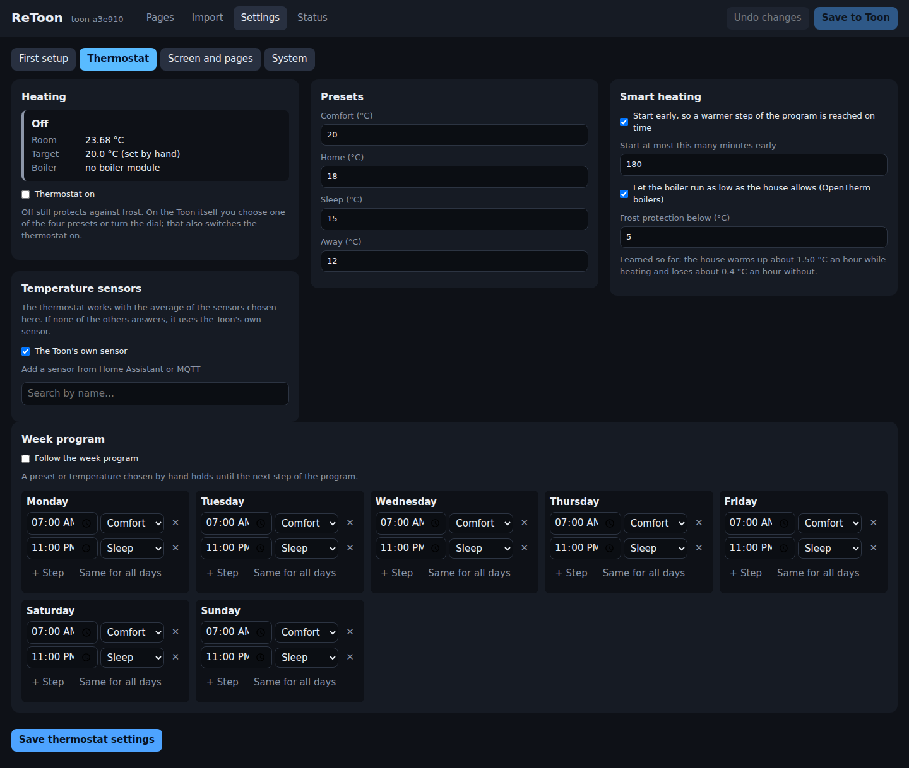

# The web interface

Open `https://<address of the Toon>/` or `https://toon-<id>.local/`. The user
name is `admin`; the password is made at the first start and shown on the
Toon (tap the Home Assistant icon). It can be changed under System, Security.

The Toon makes its own certificate at the first start, so the browser warns
once that it does not know it. The certificate's SHA-256 fingerprint is on the
same screen of the Toon and under System, Security, to compare with what the browser
shows. `http://` only sends the browser on to `https://`; plain http can be
allowed again under System, Security.

The page is in Dutch or English: the selector at the top right. It is the
Toon's own setting (`config/language`, Dutch unless it says `lang=en`), so
the Toon's screen switches with it; the screen program restarts for that.
Names you gave (pages, entities) are not translated.

Six tabs:

- **Overview**: the state of the thermostat and of every connection at a
  glance (click one to go to its settings), a few lines on what the Toon
  measures now, a notice when an update is available, and a short "Getting
  started" list until Home Assistant, the thermostat and "Always start
  ReToon" are set.
- **Screen**: the pages (below), copying pages from Home Assistant,
  brightness and dimming, and the standard pages.
- **Thermostat**: see [thermostat.md](thermostat.md).
- **Connections**: Home Assistant, MQTT with your own MQTT values and the Toon's own broker, Z-Wave,
  Bluetooth proxy, Zigbee or Thread, WiFi. Each card shows its state first;
  the explanation is folded away under "How to use this".
- **Apps**: see below.
- **System**: name, starting up, factory defaults, sound, security
  (passwords, https), details and updates. "Update by itself" in the update
  card looks for a new ReToon every hour, every night around 3:00 or every
  Sunday night; one that is found is installed and the Toon restarts, after
  which the screen shows a banner that it updated itself.

A Save button lights up only when its card has changes.



## Pages

- Left: the pages, with their name and icon.
- Middle: the cards of the selected page, in its grid as on the screen.
  Click a card to change it, or an empty cell to add a card there.
- Right: the Toon's real screen. Clicking in it taps on the Toon.

### Sizes and places

A page is a grid of 12 columns over the screen's width, and a row is one
tile high; seven rows fill the Toon's screen above the bar. Every card has
its place in it and shows its size as columns × rows:

- **Place**: drag a card to any free place; the outline shows where it lands,
  red where it does not fit (another card is there). Cells can stay empty.
  On a phone or tablet, drag it by ⠿.
- **Size**: drag a card's bottom right corner, a cell at a time, as far as
  it fits next to the other cards and what the card needs: a tile is at
  least one row, or two with an extra control; a graph at least two; the
  large thermostat dial at least four; a heading only changes width.
- **Screen ends**: a dashed line shows where the Toon's screen ends; what is
  under it is only seen by scrolling on the Toon.

The screen shows each card at exactly its cells. A new card goes where its
empty cell was clicked, or with **+ Card** in the first free place: a
quarter of the page for a tile, half for other cards.

### The dimmed home page

"Different page when the screen is dimmed" under the home page's name (the
first page) gives it a page of its own for while the screen is dimmed (Screen
tab, Brightness): it appears in the list as "Home page (dimmed)" and is
edited like any page, with 8 rows, as it has the whole screen without the
bar. It starts with a big clock. The touch that wakes the Toon only shows the
normal home page; it does not press what is under the finger.

Changes are kept in the browser until **Send to ReToon** (top right) is pressed.



A card is edited with a form: what it shows (searched by name in your Home
Assistant entities, the Toon's own values and what was found on the MQTT
broker, marked "(MQTT)"), name, icon and an extra
control such as a brightness slider. "Edit as text" shows the card as Home
Assistant writes it, for anything the form does not cover.

With "Option buttons" (a select entity), "Heating mode buttons" or "Preset
buttons" as the extra control, the form lists what the entity can be set to:
tick the ones that get a button (at most 5) and put them in order with the
arrows. Nothing ticked: all of them, in the entity's order.

"When tapped" sets what a tap on a tile does: its usual thing (switch a
light, press a button), nothing, or a Home Assistant action, given as
`domain.action` (for example `script.turn_on`), on an entity, with data as
JSON. "Ask first" shows a question with Yes and Cancel on the Toon before the
action is done.

### Example: an EV charger page

For a charger whose Home Assistant integration has a select entity for the
charging mode (most do):

1. **+ Page**, name it, for example "Charging", icon `mdi:ev-station`.
2. **+ Card**, Tile, shows: the charging mode select entity. Extra control: Option buttons. Tick the modes you want as buttons
   (for a zappi: Fast, Eco, Eco+, Stopped). Tick "Hide the state text": the
   lit button shows the mode. Drag its corner to half the page's width.
3. A tile for each value you want to see: charging power, status, plug
   status, energy this session.
4. For a boost or another action of the integration: a tile on the mode
   entity, with an icon such as `mdi:rocket-launch`, "Hide the state text",
   When tapped: Perform an action, for example `myenergi.myenergi_boost`
   with data `{ "amount": 10 }`, and "Ask first".
5. **Send to ReToon**.

The actions an integration offers, and their data, are in Home Assistant
under Developer tools, Actions. The same page as JSON is in
[screen.md](screen.md#example-an-ev-charger).

## Copying pages from Home Assistant

"Copy pages from Home Assistant…" under the page list lists the dashboards of the connected Home Assistant. Pick one, tick the
pages to copy, and add them to the Toon's pages or replace all pages with
them. The list says per page which cards will be simplified or cannot be
shown. Nothing is changed in Home Assistant. The copied pages are put into
the grid in their order, with Home Assistant's groups side by side as their
columns say; move the cards where you want them afterwards.

Dashboards that Home Assistant generates itself have no stored pages; use
"Take control" on them in Home Assistant first.

## Settings

Where the settings are kept:



| Setting | Stored in |
|---|---|
| Home Assistant: log in through Home Assistant's own login page, or paste a token yourself ("Manual token"); optional certificate check | `config/ha.conf` |
| Name of this Toon on the network (empty = `toon-<id>`) | `config/hostname` |
| Starting up: always start ReToon (off at first), or go back to the original software at the next restart | `config/autoboot` and `boot.scr` on p1 |
| MQTT broker | `config/mqtt.conf` |
| The Toon's own broker open to the network, with its user name and password | `config/broker.conf` |
| Your own MQTT values (topics that do not announce themselves) | `config/mqtt-topics.json` |
| Plain http next to https | `config/web.conf` |
| Touch calibration (Screen tab: four crosses on the Toon's screen, kept only after tapping Keep; or back to the standard one) | `config/touch.conf` |
| Normal brightness, dimming; back to the home page; sliding pages | `config/ui.conf` |
| Pages, their cards and places, the dimmed home page | `config/dashboard.json` |
| Thermostat: sensors, presets, week program, options | `config/thermostat.json` |
| Update by itself (`auto=hourly`, `nightly`, `weekly`) | `config/update.conf` |
| Update apps by themselves (there or not) | `config/apps-autoupdate` |
| Meter adapters that are read (`meters=`) | `config/zwave.conf` |
| Password of the web interface | `config/web.conf` |
| Language of the page and the screen | `config/language` |

WiFi is the one thing set on the Toon itself.

The **Apps** tab installs, updates and removes apps from the app catalogue
and holds each app's settings, see [apps.md](apps.md).

A new name is used at once for `https://<name>.local/` and a new certificate
is made for it; the router sees it after the next restart. MQTT topics and
the device in Home Assistant keep following the Toon's own id, so they do
not change with the name.

"Always start ReToon" is off until it is switched on. While it is off,
`boot.scr` is not put back on the boot partition: the next restart starts
the original software and stays there until ReToon is started from it
again with the ReToon app. Switching it off removes `boot.scr`
at once; switching it on puts it back at once.

The info screen on the Toon (the (i) in the bar) has a Restart button. It
asks first, and says where the restart goes: ReToon again, or the original
software when "Always start ReToon" is off.

### Logging in to Home Assistant

"Log in to Home Assistant" sends the browser to Home Assistant's own login
page. Back on the Toon, the one-time code is traded for a session, and in
that session the Toon asks Home Assistant for a long-lived access token named
"Toon <host name>" (valid ten years). Only that token is stored; the session
itself is removed again. The token is listed in Home Assistant under your
profile → Security, where it can be withdrawn. A token of the same name from
an earlier login is replaced.

Both `http://` and `https://` addresses work. With https the certificate is
not checked unless "Check the certificate" is ticked, because most local
installations use a certificate of their own; tick it when Home Assistant has
one from a public authority and is addressed by that name.

## Sending a message from a script

A script on another computer can put a message on the screen (the same
JSON as in [mqtt.md](mqtt.md#notifications-on-the-screen)):

```
curl -k -u admin:<password> -H 'Content-Type: application/x-toon' \
  --data '{"title": "Backup", "message": "The backup is done"}' \
  https://<toon>/cgi-bin/api/notify
```

Changes must be sent with `Content-Type: application/x-toon`. A form on
another website cannot send that, so it cannot make a logged-in browser
change the Toon.
